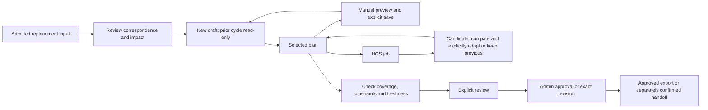

# A clearer Cursus planning workspace

Status: milestone 1 shipped in PR #46; milestone 2 implemented on `feature/compact-workspace-status`, pending validation/review. This milestone does not change production.  
Reviewed source: `b69712f22fbc3d15b261821a5bb45f071137415a`.  
Date: 30 October 2026.

Open the [interactive screen mockups](mockups/workflow-workspace.html) in a browser. They are an offline design prototype with synthetic data, not an application or customer-plan preview. Switch stages, language, role and example state. Operational buttons only explain their proposed behavior; they cannot save, optimize, approve, export or send anything.

## Decision

Organize the existing workspace around **Prepare → Plan → Review & release**. These are freely navigable views of the same selected workspace, not a wizard, permission model or persisted business state. Opening Review does not mark a plan reviewed. Opening Plan does not revoke approval. Starting in Plan remains the default for a clean existing workspace; a newly admitted input can be opened in Prepare through an explicit navigation action.

Retain the graphite chrome, warm ivory panels, green primary actions, amber warnings, Inter typography and existing icon family. This is an information hierarchy change, not a new visual brand, routing engine or optimization workflow.

## What is crowded today

`TopBar.tsx` puts issues, scenarios, week overview, saved plans, data, profiles, input updates, handoff and help in an icon-only group. Comparison, reset, solve settings and exports add further controls. In `App.tsx`, candidate decisions, KPIs, readiness, approval, policy warnings, freshness warnings and pending edits can each occupy another horizontal row.

These controls are useful individually. The problem is that navigation, plan identity, planning mutations, publication and personal view settings compete at the same visual level. The map and route list receive the space left over.

The previous [usability review](usability-review.md) remains useful evidence, but several of its correctness findings have since been implemented. This proposal builds on candidate adoption, stable delivery identity, profiles, immutable input updates, acknowledged handoff and saved workspace recovery; it does not reintroduce their earlier behavior.

## Persistent shell

1. **Brand/account chrome:** Cursus, tenant, language and Help. Keep avatar, account email, effective role, View as, build and Sign out in the existing bottom account bar. The tenant label does not introduce tenant switching.
2. **Workspace identity:** selected day/input cycle, workspace name, exact plan/revision in Details, and a labeled Library menu for workspaces, saved plans and week overview. Never silently replace the selected result when changing views.
3. **Three labeled view buttons:** Prepare, Plan, Review & release. No numbered completion marks. Reviewer can open all three in read-only mode. Preserve independent approval/coverage/freshness indicators.
4. **Compact status:** coverage and hard-constraint evidence; freshness/pending changes; approval status. Each has a direct Details destination. Unknown/loading/failed evidence is visibly Unknown, not green. Persistent critical warnings outrank the normal compact summary.
5. **One view-specific action area:** a stable location, consistent button width and visible running timer. Secondary commands live in labeled menus. Status changes must not shift neighboring controls.

Do not show a universal “Ready” badge that conflates coverage, validation, freshness, approval and downstream acceptance. Collapse detailed sections, not safety evidence.

Use three compact workspace rows on desktop: identity, views with contextual actions on the same row, then status. Do not create a separate full-width toolbar for each view heading. Target at most 220px for ordinary workspace chrome including compact KPIs, excluding brand/account chrome; measure this in the application at supported viewports before release. Extra warnings appear only when needed. In Plan, a visible candidate decision panel replaces its duplicate global warning; outside Plan, a compact persistent notice links back to that decision.

## Views

The business flow below is distinct from free navigation between the three views:

Ordinary Draft/Superseded exports remain separate. Input changes or edits create fresh evidence requirements; this diagram does not grant approval or describe receiver delivery status.

| View | Main surface | Primary action and limits |
|---|---|---|
| Prepare | Current admitted input, replacement snapshot differences, fleet/location profile references, constraints, exceptions and provenance. Group within the view rather than adding another global band. | Open planning workspace. Upload, propose, approve, bind and apply updates remain distinct explicit operations with existing confirmations. Admission never automatically replaces a plan. |
| Plan | Route/fleet list, map, contextual inspector and optional timeline. Compact KPIs appear here. Preserve manual mode, assignment origin/history, resizing and collapse controls. | Optimize/Replan when allowed. Keep existing solver settings under a labeled adjacent menu. Pending edits, evaluation and manual save remain distinct from starting a solve. |
| Review & release | Coverage/reasons, constraint evidence, exceptions, freshness, explicit comparison reference, approval and export/handoff details. Use one content surface with sections. | Depends on authoritative state: resolve blockers, mark reviewed, approve, or open export/handoff options. Never infer approval from the active view or successful solver termination. |

The mockup intentionally labels its map as a schematic. Its counts and costs are illustrative, not Gyermelyi results. A future app implementation must render existing authoritative plan metrics and existing Carta/Velo components.

### Prepare

- Present current input identity and profile revisions first; show checksums in bounded, copyable Details rather than long inline text.
- Put Upload, Update input snapshot and Provenance beside the input they affect. Keep the native conversion/admission workflow unchanged.
- Keep the source/target correspondence and impact review explicit. New drafts do not inherit approval. Preserve the full superseded-cycle scope confirmation and Admin-only exception reapproval.
- A Planner can propose profile revisions, but cannot approve them. Read-only users can inspect evidence without seeing fake actionable controls.
- Existing dialogs are retained initially. Only move their entry points in the first implementation; do not simultaneously rewrite long-running upload/conversion or snapshot publication flows.

### Plan

- Preserve fleet → route → stop inspection and the map/timeline relationship. Manual mode remains an explicit, visible toggle near the assignment tools; it is not a fourth global view.
- Put assigned, excluded and unverified resources in the existing fleet surface. Unassigned counts link directly to the corresponding orders.
- Keep one compact KPI strip with actual distance, estimated cost, vehicles, trips and service. Staged preview metrics must be labeled Preview; never replace saved totals with an uncommitted calculation.
- Keep manual Preview and Save, optimizer instructions, Replan, cancellation and Undo semantics unchanged. Retained/manual decisions must stay distinguishable from optimizer assignments.
- A returned solver result opens the existing candidate decision surface in context, with Use candidate, Keep previous and Compare. No automatic adoption and no transferred approval. A worse-coverage candidate explicitly warns against interpreting lower cost/distance as efficiency savings.
- Personal View settings contain display controls only. Preserve the existing cross-shaped map controls during the initial release. Do not replace the already learned controls and reorganize planning actions in the same change.

### Review & release

- Put approval near the evidence it certifies, not in a permanently expanded global row. Keep its compact authoritative status visible outside this view.
- Surface incomplete coverage, hard violations, stale revisions and unresolved candidate decisions before approval controls. Direct recovery links open the relevant existing planning surface; they do not change data.
- Draft exports remain available when supported, even if the plan cannot be approved. They are explicitly Draft/Superseded. Approved export requests still recheck approval on the server.
- Reviewed is not Approved. Only the appropriate role can perform each existing action. The acknowledgement checkbox remains explicit and revision-bound.
- Handoff is a separate confirmed operation with destination, exact plan/revision and receiver status. Approval is not dispatch. Accepted is not delivered. Do not display an active Send action when no destination is configured.
- Comparisons use an explicitly selected compatible saved plan. No handmade/original-plan dependency is introduced.

## Current controls → proposed home

| Current control/component | Proposed home | Preserved behavior |
|---|---|---|
| Day selector / scenario label | Persistent workspace identity | Same tenant/day/cycle/plan; archived cycle clearly labeled |
| Scenarios / Plans / Week overview | Labeled Library menu | Existing exact-plan Open and safe recovery; distinct list types |
| Data / Import | Prepare → Inputs | Same upload, conversion, admission, errors and progress |
| Input updates | Prepare → Current input | Same reviewed correspondence, preview digest and fenced publication |
| Planning profiles | Prepare → Fleet & sites | Same immutable revisions and permissions |
| Provenance | Prepare → Input details; contextual link from Review | Same checksums and source facts; bounded text |
| Optimize / Replan / settings / Cancel | Plan action area | Same queue, budgets, HGS, leases and cancellation limits |
| Manual planning / assign / deassign / exclusions / locks / Undo | Plan → fleet and inspector | Same preview/save, retained decisions, attribution and constraints |
| Issues | Compact persistent count → contextual detail | Hard blockers remain visible; direct order/route navigation |
| KPI strip | Plan; relevant totals repeated in Review | Shared calculation and comparison semantics, never duplicate state |
| ReadinessPanel | Compact status plus Review sections | Same independent coverage, constraints, exceptions and freshness |
| PlanApproval | Review, plus persistent status | Same server-authoritative workflow and acknowledgement |
| CandidatePanel / comparison | Plan decision surface, accessible from Review | No accidental adoption, approval or hidden unresolved candidate |
| Export / acknowledged handoff | Review & release | Ordinary draft exports retained; approved exports rechecked |
| Panel sizes / visibility / timeline playback | Plan → personal View controls | No planning writes; existing preferences and keyboard controls retained |
| Help / language / account controls | Persistent shell | Same auth, View as, logout and build visibility |

## State and interruption rules

| Situation | Visible behavior | Authority / recovery |
|---|---|---|
| Clean draft, full coverage | Separate Current, coverage/validation and Draft indicators | Review may be offered only when its existing gate permits it |
| Unassigned or invalid | Persistent count/severity and direct Plan link | No approval; ordinary exports remain clearly labeled |
| Pending edits/manual preview | “Saved plan + pending edits” or “Unsaved preview”; saved metrics identified | Keep the existing mutation queue, revision checks and confirmations |
| Solve running | Timer and running state remain visible in every view | View switching does not cancel or restart the solve; cancellation uses existing permission |
| Candidate awaiting a choice | Persistent “Candidate needs a decision” and return link | Existing adoption gate stays active across views; release cannot bypass it |
| Other replica changes source, selection or policy | Persistent stale warning and recovery action | No silent rebase, inferred freshness or use of a stale preview |
| Snapshot update is applying or response is ambiguous | Keep confirmation busy until resolution/navigation completes | Same operation ID and receipt recovery; no duplicate publication |
| Superseded input cycle | Read-only banner and Open updated inputs | Existing archive guard, current selected-result recovery and history retained |
| Approval/status fetch fails | Unknown with Retry; last successful evidence visibly stale | Never enable approval/Approved export from cached client status |
| Permission changes / View as | Mutating controls immediately lose access | Existing server permission checks remain authoritative; late responses cannot restore controls |

Changing views must not reset selection, filters, manual mode, preview intent, active job, candidate, approval acknowledgement or viewport preferences. Where the current workflow cannot safely keep a pending dialog open, retain its current close/confirmation policy. Layout changes must not create a new unsaved-changes policy.

State continuity applies only within the same authorized context. A changed tenant, plan/revision, policy, evidence or permission must still invalidate the relevant preview or acknowledgement. Keeping a checkbox across a view change must never reuse it for another revision.

## Accessibility, language and narrow screens

- Use text labels for the three views and Library. Reserve icon-only controls for familiar local actions with accessible names.
- Proposed EN/HU labels: Prepare / Előkészítés; Plan / Tervezés; Review & release / Ellenőrzés és átadás; Library / Tervek és munkaterületek. Validate the Hungarian operational wording with users before implementation.
- At narrow widths, keep workspace identity and critical status readable, wrap navigation, and use a fleet/map/details switch instead of squeezing three desktop columns together. This is a later layout milestone, not permission to remove functionality on mobile.
- Keyboard navigation, focus return after dialogs, visible focus and non-color severity cues are required. A view change is a UI navigation action, not a form submission.
- Layout preferences remain browser-local; no new database or cross-device preferences service. Do not store customer data or account email in new UI preference keys.

## Low-risk implementation sequence

1. **Labeled navigation only.** Extract a small workspace navigation component and group entry points. Retain existing components, handlers, personal layout and modal lifecycles. Do not move approval logic or change API payloads. Ship only after existing workflows still pass.
2. **Identity and status hierarchy.** Reuse existing readiness, freshness and approval evidence in a compact summary; put details in the appropriate view. Ensure errors, staleness and unresolved candidates cannot disappear with collapsed sections. Avoid adding a parallel client-owned approval state.
3. **Contextual work surfaces.** Move preparation and review content into their views, initially retaining existing dialogs for mutations. Preserve ordinary exports and candidate decisions. No changes to server permissions, solver parameters, database schema or native tools.
4. **Narrow-screen convenience.** Add the single-surface fleet/map/details arrangement and keyboard/focus refinements after desktop workflow equivalence is proven. Preserve existing resize/collapse preferences and recovery behavior.

Each milestone gets a separate reviewable change and exact-image acceptance. Do not combine this reorganization with new product features, customer-data conversion, solver improvements, authentication changes or infrastructure work. Return to the prior layout using a compatible app image if needed; never restore a database to undo a UI release. Preserve snapshot-update compatibility when choosing any rollback image.

## Required regression evidence before shipping application changes

| Area | Required tests |
|---|---|
| Navigation purity | Switching each view/Library/layout causes no planning writes, solve, approval, export or handoff. Tenant/day/plan/revision/selection stay consistent. |
| State continuity | Switch during pending edits, preview, solve and candidate review; reload; reopen from history; recover lost responses. No duplicated command or automatic candidate adoption. |
| Metrics | Exact KPI/stop/load/cost parity before/after the layout change. Unsaved previews are distinguishable. Reduced service never becomes “savings.” |
| Permissions | Admin/Planner/Reviewer and both View as modes, API bypass attempts, demotion/regrant during delayed responses. Hidden controls are not an authority boundary. |
| Approval/export/handoff | Revision-bound acknowledgement, concurrent edits, stale Approved export rejection, ordinary draft exports, missing destinations and ambiguous receipts. |
| Input updates | Reviewed identity pairs, changed locks, Admin-only exceptions, superseded cycles and current selected-plan navigation retain existing protection. |
| Layout/accessibility | EN/HU, desktop/short/narrow windows, long names, full keyboard path, focus restoration, collapse/resize/reset and denied/corrupt storage. |
| Runtime | Existing real two-replica PostgreSQL/object-store/native HGS acceptance and authoritative server suites pass for the exact image. Production activation remains separate. |

## Evidence for this proposal

Source inspection and the existing public-fixture workspace captures inform this design. The prototype is checked independently for stage/state/role/language switching, narrow layout and zero network calls. These checks validate only the design artifact. They are not evidence that the proposed application layout is implemented, production-tested or approved for release.

## Milestone 1 implementation

Prepare, Plan, Review & release, and Library are labeled command menus in the existing header. They open the existing dialogs or focus the existing approval section; they do not yet switch work surfaces. Help, selected day/workspace and the fixed-width Optimize/Replan controls remain directly reachable. The planning canvas, readiness, approval, manual previews, running jobs and candidate decisions remain mounted.

Menu commands reuse existing handlers, feature flags, disabled states and permission checks. This milestone adds no backend route, persisted stage, customer-data change or solver behavior. A shared menu supports keyboard navigation, outside dismissal without swallowing Optimize, viewport-clamped positioning and focus return. Controlled dialogs restore their opener when it still exists, while preserving explicit autofocus overrides.

Browser regression tests navigate through these menus and retain their existing business assertions. Additional checks cover navigation without API writes, keyboard paths and dialog focus, EN/HU at 375/600/1440 pixels for Admin/Planner/Reviewer, approval acknowledgement continuity, and the existing exact-image two-replica native workflow. Prototype checks remain separate from application acceptance. Production activation requires a subsequent release decision.

## Milestone 2 implementation: compact status

One native, keyboard-operable disclosure replaces the separate readiness and approval rows and the duplicate staged-edits bar. Its collapsed summary keeps three independent facts visible: coverage/constraints (including unassigned counts and unknown or failed checks), freshness, and approval. These are not a single green dispatch authorization. Loading, saving, running, unresolved candidates, stale or archived input, and required revalidation cannot be labeled Current.

Opening the disclosure reveals the existing readiness sections and approval controls. The approval controller owns the summary and detailed controls together; there is no parallel cached approval state or second polling loop. Closing details keeps the controller and checkbox mounted. Review & release → Plan approval opens the disclosure and focuses the existing approval section. Pending-change review is available in the details and the Plan menu.

Candidate decisions, policy/revalidation banners, stale-source recovery, errors and archive navigation remain outside the disclosure. No solver, dataset, export, permissions, API or database behavior is added. Approval/export authorization remains server-side.

Approval evidence is bound to the displayed plan/revision. Missing, failed, malformed or backward-moving responses show Unknown, with a read-only Retry action; a last-known Approved response cannot supply a fresh confirmation after a failed read. Pending work labels a previously approved snapshot as such, without claiming its approval authorizes the edited workspace. Acknowledgement persists across disclosure/menu changes, but evidence, revision, permission or read-failure changes require acknowledgement again. Late responses cannot certify another plan.

Regression coverage includes existing native solve/manual/KPI/permission/export/handoff/input-update flows, EN/HU responsive disclosure and keyboard checks for all roles, no planning writes from disclosure/retry, failure/retry and overlapping-read guards, old-plan response isolation, and cross-replica review with acknowledgement invalidation. Release evidence and production activation remain separate.
